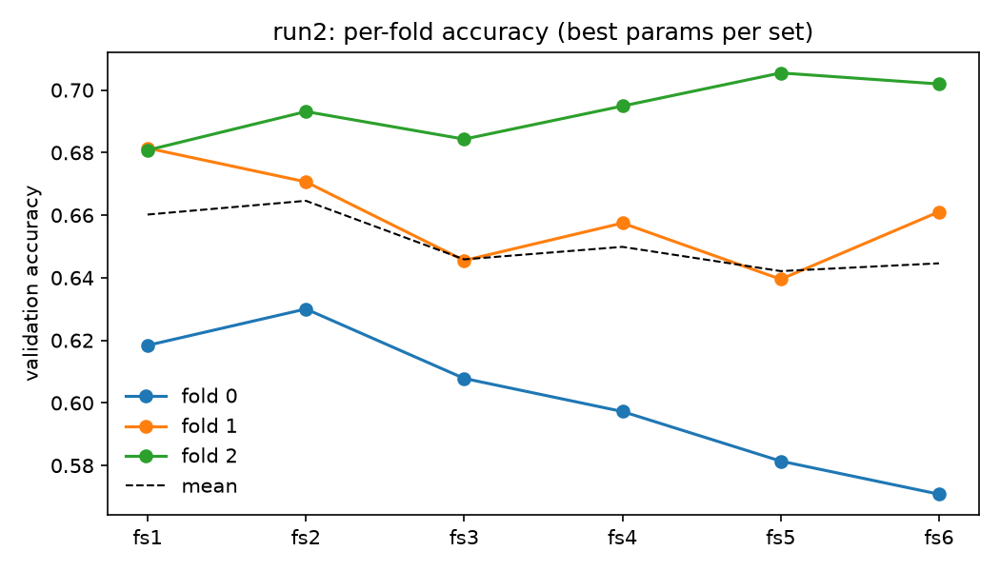

# run2: feature sets vs fs1 (2D), fold by fold

Each set uses its own best hyperparameters from run2 and the same 3 ligand-level folds
(StratifiedShuffleSplit by SMILES_class, random_state=14). Accuracy per fold is read from the saved
cv_results; macro F1 comes from refitting the best params on the same folds (no search).
Difference = set − fs1. "Beats/loses" means the 95% t-interval of the mean difference excludes 0.

## Checks

- fs1: fold mean 0.6602 vs comparison.csv 0.6602 -> OK; refit vs saved fold accuracy max gap 0.0000
- fs2: fold mean 0.6646 vs comparison.csv 0.6646 -> OK; refit vs saved fold accuracy max gap 0.0000
- fs3: fold mean 0.6459 vs comparison.csv 0.6459 -> OK; refit vs saved fold accuracy max gap 0.0000
- fs4: fold mean 0.6499 vs comparison.csv 0.6499 -> OK; refit vs saved fold accuracy max gap 0.0000
- fs5: fold mean 0.6421 vs comparison.csv 0.6421 -> OK; refit vs saved fold accuracy max gap 0.0000
- fs6: fold mean 0.6446 vs comparison.csv 0.6446 -> OK; refit vs saved fold accuracy max gap 0.0000

## Paired comparison

| featureset | metric | n_folds | mean_diff | ci95_low | ci95_high | better | worse | tied | t_test_p | wilcoxon_p |
|---|---|---|---|---|---|---|---|---|---|---|
| fs2 | accuracy | 3 | 0.0044 | -0.0283 | 0.0371 | 2 | 1 | 0 | 0.6209 | 0.5 |
| fs3 | accuracy | 3 | -0.0143 | -0.064 | 0.0353 | 1 | 2 | 0 | 0.3405 | 0.5 |
| fs4 | accuracy | 3 | -0.0103 | -0.063 | 0.0424 | 1 | 2 | 0 | 0.4878 | 0.5 |
| fs5 | accuracy | 3 | -0.0181 | -0.1103 | 0.0741 | 1 | 2 | 0 | 0.4878 | 0.5 |
| fs6 | accuracy | 3 | -0.0156 | -0.1016 | 0.0704 | 1 | 2 | 0 | 0.517 | 0.75 |
| fs2 | f1_macro | 3 | -0.0046 | -0.047 | 0.0378 | 2 | 1 | 0 | 0.6844 | 1.0 |
| fs3 | f1_macro | 3 | -0.0437 | -0.099 | 0.0116 | 0 | 3 | 0 | 0.0766 | 0.25 |
| fs4 | f1_macro | 3 | -0.0282 | -0.096 | 0.0395 | 1 | 2 | 0 | 0.2148 | 0.5 |
| fs5 | f1_macro | 3 | -0.0311 | -0.1418 | 0.0796 | 1 | 2 | 0 | 0.3502 | 0.5 |
| fs6 | f1_macro | 3 | -0.0318 | -0.1321 | 0.0685 | 1 | 2 | 0 | 0.3056 | 0.5 |

## Verdict

- **fs2**: no detectable difference from 2D on accuracy (mean diff +0.0044, 95% CI -0.0283 to +0.0371, better/worse/tied 2/1/0); macro F1: no detectable difference from 2D.
- **fs3**: no detectable difference from 2D on accuracy (mean diff -0.0143, 95% CI -0.0640 to +0.0353, better/worse/tied 1/2/0); macro F1: no detectable difference from 2D.
- **fs4**: no detectable difference from 2D on accuracy (mean diff -0.0103, 95% CI -0.0630 to +0.0424, better/worse/tied 1/2/0); macro F1: no detectable difference from 2D.
- **fs5**: no detectable difference from 2D on accuracy (mean diff -0.0181, 95% CI -0.1103 to +0.0741, better/worse/tied 1/2/0); macro F1: no detectable difference from 2D.
- **fs6**: no detectable difference from 2D on accuracy (mean diff -0.0156, 95% CI -0.1016 to +0.0704, better/worse/tied 1/2/0); macro F1: no detectable difference from 2D.

## Caveats

- Only 3 folds. The t-interval has 2 degrees of freedom, so it is wide.
- With 3 folds the exact two-sided Wilcoxon p-value cannot go below 0.2500, so it can never
  reach 0.05 here.
- The folds come from StratifiedShuffleSplit, so validation ligands can overlap between folds; the
  folds are not independent, and the t-test treats them as if they were.

